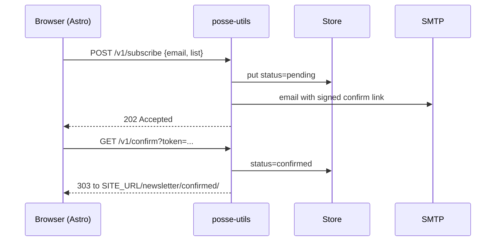

# Architecture

## Goals

- One small service that a static site can call.
- Scale to zero on Cloud Run; effectively free at newsletter volume.
- Room to grow (events, syndication) without splitting into many deployables.
- Business rules testable without network access.

## Package layout

```text
cmd/server/            process wiring, graceful shutdown
internal/config/       environment loading and validation
internal/token/        HMAC-signed, expiring, purpose-bound tokens
internal/store/        Store interface; Memory (tests, dev) and Firestore
internal/mail/         Sender interface; SMTPSender, LogSender, Outbox (test fake)
internal/newsletter/   Service (rules) and Handler (HTTP)
internal/server/       root router, /healthz, CORS
```

Dependencies point inward: `newsletter` depends on the `store.Store` and
`mail.Sender` interfaces, never on Firestore or SMTP directly. `main` chooses the
implementations from configuration.

## Double opt-in flow



Status transitions:

| From | Event | To |
| --- | --- | --- |
| (none) | subscribe | pending |
| pending | subscribe again | pending (a new email is sent) |
| pending | confirm | confirmed |
| confirmed | subscribe | confirmed (silently ignored, no email) |
| confirmed | unsubscribe | unsubscribed |
| unsubscribed | subscribe | pending |
| unsubscribed | old confirm link | rejected |

## Tokens

A token is `base64url(JSON payload) + "." + base64url(HMAC-SHA256)`. The payload
holds email, list, purpose and expiry. It is stateless: nothing is stored to
validate it, and expiry is enforced on verification.

- The **purpose** (`confirm` or `unsubscribe`) is signed in, so a confirmation link
  cannot unsubscribe anyone, and the other way round.
- Confirmation links live 24 hours by default. Unsubscribe links live 10 years.
- The HMAC is compared in constant time.
- Rotating `TOKEN_SECRET` invalidates every outstanding link.

## Storage

Firestore, one document per subscriber in the `subscribers` collection:

```text
subscribers/{sha256(list + 0x00 + email)}
  email, list, status, createdAt, confirmedAt
```

Hashing the pair makes `(list, email)` unique by construction and keeps email
addresses out of document paths.

Planned for events:

```text
events/{eventId}                      title, date, capacity, status
events/{eventId}/signups/{emailHash}  name, email, status, createdAt, answers
```

Capacity checks will use a Firestore transaction (read the count, then write).

## Security decisions

| Concern | Measure |
| --- | --- |
| Email enumeration | `/v1/subscribe` answers `202` for every valid request, including already-confirmed addresses |
| Open relay | The list name must be in the `LISTS` allow-list; only the confirm email is ever sent |
| Bots | Honeypot field `website`; non-empty requests get `202` but are dropped |
| Cross-origin abuse | CORS only allows `SITE_URL` |
| Large bodies | Request bodies are limited to 4 KiB |
| Header injection | Newlines in recipient, subject or sender are rejected; the subject is MIME-encoded |
| Token tampering | HMAC verification, purpose binding, expiry |
| Secrets | Passed as environment variables, sourced from Secret Manager in production |
| Container | Distroless, non-root, static binary |

Known gaps: no per-IP or per-email rate limiting and no CAPTCHA. Until those exist,
keep Cloud Run `--max-instances` low (see [Deployment](deployment.md)). Re-submitting
a pending address sends another confirmation, so this is the main abuse vector.

## Why not Supabase or several functions

Cloud Run bills per request, so one service with several routes costs the same as
several functions while sharing one deploy, one set of secrets and common code.
Firestore covers subscriber and event records without running a relational
database. If cross-event reporting becomes necessary, export to BigQuery.
